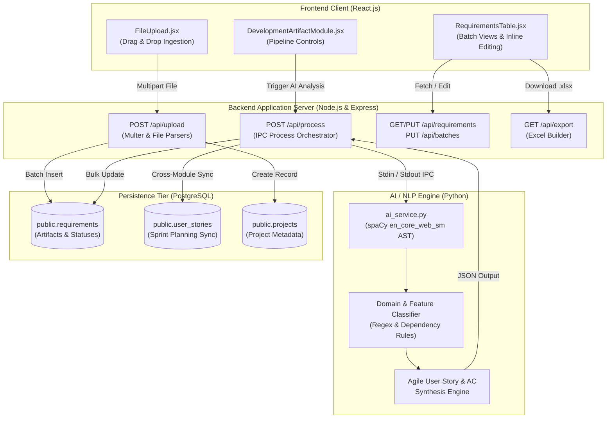
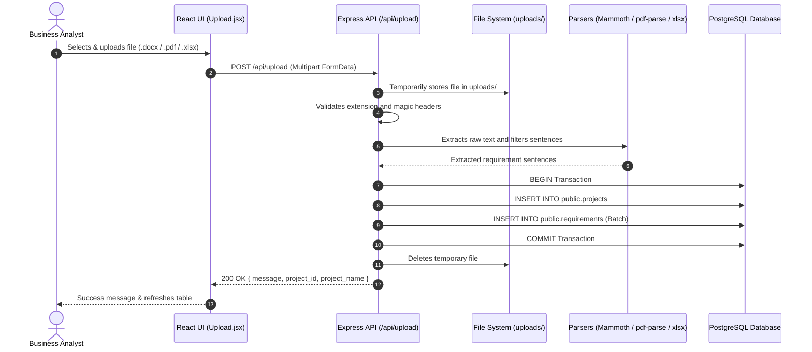
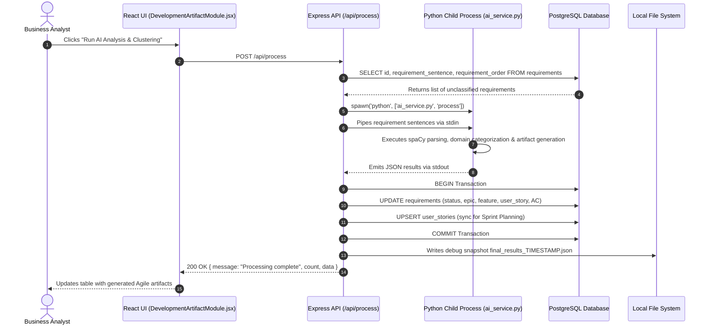

# Test Specification Document
## Development Artifact Engineering Module (Module 1)

**Project Title:** AI-Powered Requirements Engineering & Agile Sprint Allocation Platform  
**Module Name:** Module 1 – Development Artifact Engineering  
**Version:** 1.0  
**Target Architecture:** Full-Stack Web Application (React.js, Node.js/Express, Python spaCy & scikit-learn, PostgreSQL)  
**Document Type:** Formal Test Cases & Verification Specification (Unit and Integration Testing)  

---

## 1. Executive Summary & Scope

The **Development Artifact Engineering Module** is the foundational subsystem of the platform. It transforms unstructured client requirements into standardized Agile development artifacts. The module's pipeline comprises:

1. **Document Ingestion:** Multi-format file parsing (`.docx`, `.doc`, `.pdf`, `.xlsx`, `.xls`, `.csv`), magic-byte integrity verification, and noise removal.
2. **NLP Completeness Validation:** Grammatical dependency parsing via `spaCy` to verify RFC 2119 compliance (Subject, Verb, Modal keyword, Length).
3. **Dynamic Architecture Extraction:** Semantic domain classification and dependency parsing to determine Epics and Features.
4. **Agile Artifact Generation:** Dynamic synthesis of standard User Stories (`As a <Role>, I want to <Action> so that <Goal>`) and Gherkin-formatted Acceptance Criteria (`Scenario: ... Given ... When ... Then ... And ...`).
5. **Data Persistence & Batch Management:** Multi-row batch insertion, project association, inline requirement edits, and batch renaming.
6. **Cross-Module Handoff:** Synchronization with the `user_stories` table and bridging requirements into the automated Sprint Planning and Cadence Wizard.

This document details **Unit Test Cases** and **Integration Test Cases** designed to validate every tier of this subsystem.

---

## 2. System Architecture & Component Traceability



---

## 3. Unit Test Specifications

Unit tests focus on validating single functions, components, and algorithmic routines in complete isolation.

### 3.1 AI Engine & NLP Unit Tests (`ai_service.py`)

#### TC-UNIT-NLP-001: Short Requirement Boundary Check
- **Component:** `ai_service.py` -> `check_completeness(text)`
- **Objective:** Verify that sentences with fewer than 5 words are classified as incomplete.
- **Preconditions:** `spaCy` model loaded.
- **Test Input:** `"The system"` (word count = 2)
- **Execution Steps:**
  1. Pass `"The system"` to `check_completeness()`.
  2. Evaluate returned string.
- **Expected Outcome:** Returns `"Incomplete: Too short"`.
- **Assertion:** `assert check_completeness("The system") == "Incomplete: Too short"`
- **Severity / Priority:** High / P1

#### TC-UNIT-NLP-002: Missing Nominal Subject Detection (`nsubj`)
- **Component:** `ai_service.py` -> `check_completeness(text)`
- **Objective:** Detect when a requirement specifies an action and modal verb but omits the actor/subject.
- **Preconditions:** `spaCy` dependency tree parser active.
- **Test Input:** `"Shall record and store patient vital signs."`
- **Execution Steps:**
  1. Parse input sentence dependency tree.
  2. Check for tokens with `dep_ in ('nsubj', 'nsubjpass')`.
- **Expected Outcome:** Returns `"Incomplete: Missing a subject (Who/What?)"`.
- **Assertion:** `assert "Missing a subject" in check_completeness("Shall record and store patient vital signs.")`
- **Severity / Priority:** High / P1

#### TC-UNIT-NLP-003: Missing Predicate Action Verb Detection (`VERB` / `AUX`)
- **Component:** `ai_service.py` -> `check_completeness(text)`
- **Objective:** Detect sentences lacking an active operational verb.
- **Preconditions:** POS tagging available.
- **Test Input:** `"The system shall a good performance always."`
- **Execution Steps:**
  1. Inspect POS tags of all tokens.
  2. Verify if any token has `pos_ in ('VERB', 'AUX')` excluding pure modals.
- **Expected Outcome:** Returns `"Incomplete: Missing an action (Does what?)"`.
- **Assertion:** `assert "Missing an action" in check_completeness("The system shall a good performance always.")`
- **Severity / Priority:** High / P1

#### TC-UNIT-NLP-004: Missing RFC 2119 Modal Keyword
- **Component:** `ai_service.py` -> `check_completeness(text)`
- **Objective:** Ensure non-mandatory or ambiguous language without standard keywords (`shall`, `must`, `should`, `will`) is flagged.
- **Preconditions:** Lemmatizer active.
- **Test Input:** `"Users can update their personal profile information."`
- **Execution Steps:**
  1. Check lemma of tokens against mandatory set `['shall', 'should', 'must', 'will']`.
- **Expected Outcome:** Returns `"Incomplete: Missing a requirement keyword (shall/must)"`.
- **Assertion:** `assert "Missing a requirement keyword" in check_completeness("Users can update their personal profile information.")`
- **Severity / Priority:** High / P1

#### TC-UNIT-NLP-005: Fully Valid Requirement Evaluation
- **Component:** `ai_service.py` -> `check_completeness(text)`
- **Objective:** Confirm grammatically complete requirement sentence passes all checks.
- **Test Input:** `"The system shall allow users to update patient records."`
- **Execution Steps:**
  1. Evaluate sentence for word count >= 5, presence of subject, verb, and modal verb.
- **Expected Outcome:** Returns `"Complete"`.
- **Assertion:** `assert check_completeness("The system shall allow users to update patient records.") == "Complete"`
- **Severity / Priority:** High / P1

#### TC-UNIT-NLP-006: Action Verb Normalization
- **Component:** `ai_service.py` -> `normalize_verb(verb)`
- **Objective:** Verify synonym verbs map to their canonical cluster name.
- **Test Input:** Series of verbs: `"modify"`, `"amend"`, `"alter"`, `"revise"`
- **Execution Steps:**
  1. Pass each verb into `normalize_verb(verb)`.
- **Expected Outcome:** All test verbs return `"update"`.
- **Assertion:** `assert all(normalize_verb(v) == "update" for v in ["modify", "amend", "alter", "revise"])`
- **Severity / Priority:** Medium / P2

#### TC-UNIT-NLP-007: Lemmatization Quirks & Noun Normalization
- **Component:** `ai_service.py` -> `normalize_noun(noun)`
- **Objective:** Correct irregular spaCy lemmatization tokens to standard domain nouns.
- **Test Input:** Tokens: `"datum"`, `"criterion"`, `"admin"`, `"auth"`
- **Execution Steps:**
  1. Pass each token into `normalize_noun(noun)`.
- **Expected Outcome:** Returns `"data"`, `"criteria"`, `"administration"`, `"authentication"`.
- **Assertion:** `assert normalize_noun("datum") == "data" and normalize_noun("admin") == "administration"`
- **Severity / Priority:** Medium / P2

#### TC-UNIT-NLP-008: Domain Classification: User Access & Role Governance
- **Component:** `ai_service.py` -> `classify_requirement_domain(text)`
- **Objective:** Ensure security and role-related sentences map to the Access Control Epic and Feature.
- **Test Input:** `"The system shall restrict role actions based on user account privileges."`
- **Execution Steps:**
  1. Pass input string to `classify_requirement_domain()`.
- **Expected Outcome:**
  - `epic == "User Access Control & Role Governance"`
  - `feature == "Role Permission & Action Restriction"`
- **Assertion:**
  ```python
  epic, feat = classify_requirement_domain("The system shall restrict role actions based on user account privileges.")
  assert epic == "User Access Control & Role Governance"
  assert feat == "Role Permission & Action Restriction"
  ```
- **Severity / Priority:** High / P1

#### TC-UNIT-NLP-009: Domain Classification: Defect & Quality Management
- **Component:** `ai_service.py` -> `classify_requirement_domain(text)`
- **Objective:** Ensure defect, repair, and inspection sentences categorize into Defect Management.
- **Test Input:** `"The supervisor shall assign severity level to defect repair requests."`
- **Execution Steps:**
  1. Pass input string to `classify_requirement_domain()`.
- **Expected Outcome:**
  - `epic == "Defect & Quality Management"`
  - `feature == "Repair Priority & Severity Management"`
- **Severity / Priority:** High / P1

#### TC-UNIT-NLP-010: Dynamic Agile User Story Generation
- **Component:** `ai_service.py` -> `process_all_requirements(reqs)`
- **Objective:** Validate generation of standardized User Story from requirement sentence with clause splitting.
- **Test Input:** `["The onshore engineer shall enter equipment power ratings so that system calculations are accurate."]`
- **Execution Steps:**
  1. Pass requirement list to `process_all_requirements()`.
  2. Inspect `user_story` attribute of output element.
- **Expected Outcome:** Generated User Story matches:
  `"As a System User, I want to enter equipment power ratings so that system calculations are accurate."`
- **Severity / Priority:** High / P1

#### TC-UNIT-NLP-011: Gherkin Acceptance Criteria Generation
- **Component:** `ai_service.py` -> `process_all_requirements(reqs)`
- **Objective:** Confirm acceptance criteria structure adheres to Gherkin syntax.
- **Test Input:** `["The system shall generate defect reports."]`
- **Execution Steps:**
  1. Call `process_all_requirements()` and inspect `acceptance_criteria`.
- **Expected Outcome:** String contains:
  - `Scenario: Verify ...`
  - `1. Given the system is ready for ...`
  - `2. When the user initiates: ...`
  - `3. Then the system must validate the request against ...`
  - `4. And the ... state should be updated successfully.`
- **Severity / Priority:** Medium / P2

---

### 3.2 Backend Document Ingestion & Parsers (`server.js`)

#### TC-UNIT-PARSER-001: Header and Noise Filtering
- **Component:** `server.js` -> `extractRequirementsFromText(rawText)`
- **Objective:** Confirm non-requirement document elements are filtered out.
- **Test Input:**
  ```text
  Table of Contents
  Page 1 of 12
  Software Requirements Specification
  The system shall record user logins.
  Prepared by Business Analyst
  The system shall display overtime hours.
  ```
- **Execution Steps:**
  1. Pass raw text block to `extractRequirementsFromText()`.
- **Expected Outcome:** Returns array of exactly 2 sentences:
  1. `"The system shall record user logins."`
  2. `"The system shall display overtime hours."`
- **Assertion:** `expect(result).toHaveLength(2)`
- **Severity / Priority:** High / P1

#### TC-UNIT-PARSER-002: Prefix Stripping
- **Component:** `server.js` -> `extractRequirementsFromText(rawText)`
- **Objective:** Clean identifier prefixes (`REQ-01:`, `FR-12.1.`, bullets) from extracted sentences.
- **Test Input:** `"REQ-042: The system shall encrypt stored passwords."`
- **Execution Steps:**
  1. Run extraction function on prefixed sentence.
- **Expected Outcome:** Returns `"The system shall encrypt stored passwords."` (prefix cleanly removed).
- **Assertion:** `expect(result[0]).toBe("The system shall encrypt stored passwords.")`
- **Severity / Priority:** Medium / P2

#### TC-UNIT-PARSER-003: Magic Header Check: Valid PDF
- **Component:** `server.js` -> Magic Byte Check
- **Objective:** Verify genuine PDF documents with `%PDF` header are approved.
- **Test Input:** Buffer starting with bytes `[0x25, 0x50, 0x44, 0x46]` (`%PDF-1.4...`).
- **Execution Steps:**
  1. Evaluate buffer slice `(0, 4)`.
- **Expected Outcome:** Validation succeeds; proceeds to `pdf-parse`.
- **Severity / Priority:** High / P1

#### TC-UNIT-PARSER-004: Magic Header Check: Corrupted File Rejection
- **Component:** `server.js` -> Magic Byte Check
- **Objective:** Reject renamed files (e.g., text file renamed to `.pdf` or `.docx`).
- **Test Input:** Text string `"Fake PDF file"` saved as `fake.pdf`.
- **Execution Steps:**
  1. Pass file buffer to upload handler.
- **Expected Outcome:** Magic check detects missing `%PDF` signature; throws HTTP 400 with corrupted file message.
- **Severity / Priority:** High / P1

---

### 3.3 Frontend Component Unit Tests (React)

#### TC-UNIT-FE-001: Disallowed File Type Interception
- **Component:** `Upload.jsx`
- **Objective:** Ensure files with invalid extensions cannot be submitted.
- **Test Input:** File object: `{ name: "script.exe", size: 1024 }`
- **Execution Steps:**
  1. Simulate file selection on `<input type="file">`.
  2. Inspect component error state.
- **Expected Outcome:**
  - `file` state remains `null`.
  - UI displays error message: *"Invalid file format. Please upload a valid requirements document..."*
- **Severity / Priority:** High / P1

#### TC-UNIT-FE-002: Process Button State Guard
- **Component:** `DevelopmentArtifactModule.jsx`
- **Objective:** Verify *"Run AI Analysis & Clustering"* button is disabled when requirement list is empty.
- **Test Input:** `requirements = []`, `loading = false`
- **Execution Steps:**
  1. Render component with empty requirements prop.
  2. Inspect button DOM attribute `disabled`.
- **Expected Outcome:** Button has `disabled={true}`.
- **Severity / Priority:** Medium / P2

#### TC-UNIT-FE-003: Inline Edit Cancel Action
- **Component:** `RequirementsTable.jsx`
- **Objective:** Verify editing can be cancelled without committing changes.
- **Test Input:** Click edit icon on requirement row (`id = 1`), edit text, click *"CANCEL"*.
- **Execution Steps:**
  1. Trigger `startEdit(req)`.
  2. Change `editValue`.
  3. Trigger `cancelEdit()`.
- **Expected Outcome:**
  - `editingId` reverts to `null`.
  - Original requirement text is displayed.
- **Severity / Priority:** Medium / P2

---

## 4. Integration Test Specifications

Integration tests evaluate data flow across boundaries: Frontend -> REST Endpoints -> Python NLP Subprocess -> PostgreSQL Database -> File Exporter.

### 4.1 Document Upload & Ingestion Integration (`POST /api/upload`)



#### TC-INT-UPL-001: End-to-End Document Upload and Database Ingestion
- **Interfaces:** `Upload.jsx` -> `POST /api/upload` -> File Parsers -> PostgreSQL `requirements` & `projects` tables.
- **Preconditions:** Backend server and PostgreSQL database active.
- **Test Data:** `sample_requirements.docx` containing 8 functional requirements.
- **Execution Steps:**
  1. Upload `sample_requirements.docx` with `project_name = "Fleet Operations ERP"`.
  2. Inspect HTTP response status and body.
  3. Query `public.projects` table: `SELECT * FROM public.projects WHERE project_name = 'Fleet Operations ERP'`.
  4. Query `public.requirements` table: `SELECT * FROM public.requirements WHERE batch_name = 'Fleet Operations ERP'`.
- **Expected Outcome:**
  1. Endpoint returns HTTP 200 with `{ message: "File uploaded and project created successfully", project_id: "...", project_name: "Fleet Operations ERP" }`.
  2. `public.projects` contains a new project record.
  3. `public.requirements` contains 8 rows with matching `project_id`.
  4. Temporary file in `backend/uploads/` is cleanly deleted.
- **Pass/Fail Criteria:** HTTP 200 received AND 8 rows present in database AND temp file removed.
- **Severity / Priority:** Critical / P0

#### TC-INT-UPL-002: Corrupted Document Upload Rejection & Transaction Rollback
- **Interfaces:** `Upload.jsx` -> `POST /api/upload` -> File Header Verifier.
- **Preconditions:** Server active.
- **Test Data:** A plain text file containing random characters renamed to `corrupt.docx`.
- **Execution Steps:**
  1. POST the file to `/api/upload`.
  2. Check response status and error message.
  3. Query database to confirm no orphan records exist.
- **Expected Outcome:**
  1. HTTP 400 returned with `{ error: "The uploaded file is corrupted or unreadable. Please check the file and try again." }`.
  2. No rows created in `public.requirements` or `public.projects`.
  3. Uploaded temporary file deleted from disk.
- **Pass/Fail Criteria:** HTTP 400 AND no database modification.
- **Severity / Priority:** High / P1

#### TC-INT-UPL-003: Empty Document Handling
- **Interfaces:** `POST /api/upload` -> Text Extractor.
- **Test Data:** A valid `.xlsx` file containing only column headers without requirement rows.
- **Execution Steps:**
  1. Upload empty `.xlsx` file.
  2. Inspect response.
- **Expected Outcome:**
  1. HTTP 400 returned with message: `"The uploaded document is empty or contains no valid requirements. Please upload a document containing requirements."`.
- **Severity / Priority:** Medium / P2

---

### 4.2 Requirements Retrieval & Management Integration

#### TC-INT-REQ-001: Filter Requirements by Project ID
- **Interfaces:** `GET /api/requirements` -> PostgreSQL `requirements` table.
- **Preconditions:** Database contains 5 requirements for project `P00001` and 8 requirements for project `P00002`.
- **Execution Steps:**
  1. Send `GET /api/requirements?project_id=P00001`.
  2. Inspect response array.
- **Expected Outcome:**
  1. HTTP 200 returned with an array of exactly 5 requirement objects.
  2. Every returned item has `project_id === 'P00001'`.
  3. Records are ordered by `requirement_order ASC, id ASC`.
- **Severity / Priority:** High / P1

#### TC-INT-REQ-002: Manual Requirement Inline Edit Persistence
- **Interfaces:** `RequirementsTable.jsx` -> `PUT /api/requirements/:id` -> PostgreSQL.
- **Preconditions:** Existing requirement row with `id = 10` and `completeness_status = 'Pending'`.
- **Execution Steps:**
  1. Send `PUT /api/requirements/10` with body:
     ```json
     { "requirement_sentence": "The system shall encrypt all stored patient records." }
     ```
  2. Query database for `id = 10`.
- **Expected Outcome:**
  1. HTTP 200 returned with `{ message: "Requirement updated successfully" }`.
  2. In database, `requirement_sentence` is updated to the new string.
  3. `completeness_status` is updated to `'Completed by User'`.
- **Severity / Priority:** High / P1

#### TC-INT-REQ-003: Batch Folder Renaming
- **Interfaces:** `RequirementsTable.jsx` -> `PUT /api/batches/:timestamp` -> PostgreSQL.
- **Preconditions:** 6 requirements sharing `created_at = "2026-10-11T14:30:00.000Z"` with default batch name.
- **Execution Steps:**
  1. Send `PUT /api/batches/2026-10-11T14%3A30%3A00.000Z` with body:
     ```json
     { "batch_name": "Sprint 1 Defect Requirements" }
     ```
  2. Query database for matching `created_at`.
- **Expected Outcome:**
  1. HTTP 200 returned with `{ message: "Batch renamed successfully", count: 6 }`.
  2. All 6 matching records have `batch_name = "Sprint 1 Defect Requirements"`.
- **Severity / Priority:** Medium / P2

---

### 4.3 AI & ML Pipeline Subprocess Integration (`POST /api/process`)



#### TC-INT-AI-001: End-to-End AI ML Pipeline Processing
- **Interfaces:** `DevelopmentArtifactModule.jsx` -> `POST /api/process` -> `ai_service.py` -> PostgreSQL `requirements` and `user_stories` tables.
- **Preconditions:** 10 raw requirements stored in `requirements` with empty `epic`, `user_story`, and `acceptance_criteria`.
- **Execution Steps:**
  1. Send `POST /api/process`.
  2. Inspect response status and structure.
  3. Inspect `requirements` table in PostgreSQL.
  4. Inspect `user_stories` table in PostgreSQL.
- **Expected Outcome:**
  1. HTTP 200 returned with `{ message: "Processing complete", count: 10, data: [...] }`.
  2. In `requirements`, all 10 records have populated:
     - `completeness_status` (`"Complete"` or `"Incomplete: ..."`)
     - `epic` (e.g., `"User Access Control & Role Governance"`, `"Defect & Quality Management"`)
     - `feature` (e.g., `"Role Permission & Action Restriction"`)
     - `user_story` (starts with `"As a System User, I want..."`)
     - `acceptance_criteria` (contains Gherkin `Given/When/Then`)
  3. In `user_stories`, corresponding entries are upserted with `story_id = US-{id}`.
- **Severity / Priority:** Critical / P0

#### TC-INT-AI-002: Fallback Engine Activation on Python Process Failure
- **Interfaces:** `POST /api/process` -> Internal Node Fallback `generateDynamicArtifacts()`.
- **Preconditions:** Python script intentionally fails (simulated syntax error or missing python binary).
- **Execution Steps:**
  1. Send `POST /api/process`.
  2. Monitor server logs and database state.
- **Expected Outcome:**
  1. Server logs: `"Python script error: ..."`
  2. Fallback engine `generateDynamicArtifacts()` executes automatically.
  3. Database is updated with fallback Epics, Features, User Stories, and Acceptance Criteria.
  4. Response succeeds with HTTP 200 without crashing the Express server.
- **Severity / Priority:** High / P1

#### TC-INT-AI-003: Debug JSON File Snapshot Generation
- **Interfaces:** `POST /api/process` -> Local File System.
- **Preconditions:** Requirements batch processed via `/api/process`.
- **Execution Steps:**
  1. Trigger `/api/process`.
  2. Inspect directory `backend/`.
- **Expected Outcome:**
  1. A file named `final_results_YYYY-MM-DDTHH-mm-ss-sssZ.json` is created.
  2. File contains valid formatted JSON matching the response payload.
- **Severity / Priority:** Low / P3

---

### 4.4 Export & Cross-Module Sprint Planning Bridge

#### TC-INT-EXP-001: Excel Batch Export
- **Interfaces:** `RequirementsTable.jsx` -> `GET /api/export/batch?timestamp=...` -> `xlsx` library.
- **Preconditions:** Batch with timestamp `"2026-10-11T15:00:00.000Z"` exists in database.
- **Execution Steps:**
  1. Send `GET /api/export/batch?timestamp=2026-10-11T15%3A00%3A00.000Z`.
  2. Inspect HTTP response headers and downloaded binary file.
- **Expected Outcome:**
  1. Response header: `Content-Type: application/vnd.openxmlformats-officedocument.spreadsheetml.sheet`.
  2. Binary payload is a valid Excel workbook containing sheet named `"Batch Artifacts"`.
  3. Columns include: `requirement_sentence`, `completeness_status`, `epic`, `feature`, `user_story`, `acceptance_criteria`.
  4. Temporary file on server disk is deleted post-download.
- **Severity / Priority:** High / P1

#### TC-INT-WIZ-001: Bridge Requirements to Sprint Planning & Cadence Wizard
- **Interfaces:** `RequirementsTable.jsx` -> `SprintTimelineWizardModal.jsx` -> `POST http://localhost:8082/api/import-requirements`.
- **Preconditions:** Processed requirement batch displayed in UI; Sprint Planning service active on port 8082.
- **Execution Steps:**
  1. Click `"Plan Sprints"` on a requirement batch folder.
  2. Configure 7-question wizard (Organization: `Private Tech`, Cadence: `2 weeks`, Buffer: `10%`).
  3. Click `"Generate Sprint Plan & Gantt Timeline"`.
- **Expected Outcome:**
  1. Frontend sends batch requirements and timeline settings to `POST http://localhost:8082/api/import-requirements`.
  2. Success alert banner appears with sprint count and total story points.
  3. `localStorage` persists `planned_sprints_{email}` and `active_requirements_batch`.
  4. UI automatically redirects to the Sprint Plan / Gantt view.
- **Severity / Priority:** High / P1

---

## 5. Traceability Matrix

| Requirement / Capability | Component(s) | Unit Test Case | Integration Test Case | Verification Status |
| :--- | :--- | :--- | :--- | :--- |
| **Document Ingestion (.docx, .pdf, .xlsx)** | `Upload.jsx`, `server.js` | TC-UNIT-PARSER-003, TC-UNIT-PARSER-004, TC-UNIT-FE-001 | TC-INT-UPL-001, TC-INT-UPL-002, TC-INT-UPL-003 | Planned / Ready |
| **Noise & Header Filtering** | `server.js` | TC-UNIT-PARSER-001, TC-UNIT-PARSER-002 | TC-INT-UPL-001 | Planned / Ready |
| **NLP Completeness Validation** | `ai_service.py` | TC-UNIT-NLP-001, TC-UNIT-NLP-002, TC-UNIT-NLP-003, TC-UNIT-NLP-004, TC-UNIT-NLP-005 | TC-INT-AI-001 | Planned / Ready |
| **Verb/Noun Normalization** | `ai_service.py` | TC-UNIT-NLP-006, TC-UNIT-NLP-007 | TC-INT-AI-001 | Planned / Ready |
| **Epic & Feature Extraction** | `ai_service.py`, `server.js` | TC-UNIT-NLP-008, TC-UNIT-NLP-009 | TC-INT-AI-001 | Planned / Ready |
| **Agile User Story Synthesis** | `ai_service.py` | TC-UNIT-NLP-010 | TC-INT-AI-001 | Planned / Ready |
| **Gherkin AC Generation** | `ai_service.py` | TC-UNIT-NLP-011 | TC-INT-AI-001 | Planned / Ready |
| **Database Multi-Row Ingestion** | `server.js`, PostgreSQL | N/A (Integration) | TC-INT-UPL-001 | Planned / Ready |
| **Inline Requirement Editing** | `RequirementsTable.jsx`, `server.js` | TC-UNIT-FE-003 | TC-INT-REQ-002 | Planned / Ready |
| **Batch Folder Management** | `RequirementsTable.jsx`, `server.js` | N/A (Integration) | TC-INT-REQ-003 | Planned / Ready |
| **Fail-Safe Fallback Generation** | `server.js` | N/A (Integration) | TC-INT-AI-002 | Planned / Ready |
| **Excel Export (.xlsx)** | `RequirementsTable.jsx`, `server.js` | N/A (Integration) | TC-INT-EXP-001 | Planned / Ready |
| **Sprint Planning Handoff** | `RequirementsTable.jsx`, `SprintTimelineWizardModal.jsx` | N/A (Integration) | TC-INT-WIZ-001 | Planned / Ready |

---

## 6. Execution Guidelines

### 6.1 Executing Python NLP Unit Tests
```bash
# Navigate to backend/ml_model directory
cd backend/ml_model

# Run tests using pytest
pytest test_clustering.py -v
```

### 6.2 Executing Backend Node.js API Integration Tests
```bash
# Navigate to backend directory
cd backend

# Execute test suite using Jest / Supertest
npm test
```

### 6.3 Executing Frontend React Component Tests
```bash
# Navigate to frontend directory
cd frontend

# Execute frontend component tests
npm run test
```
